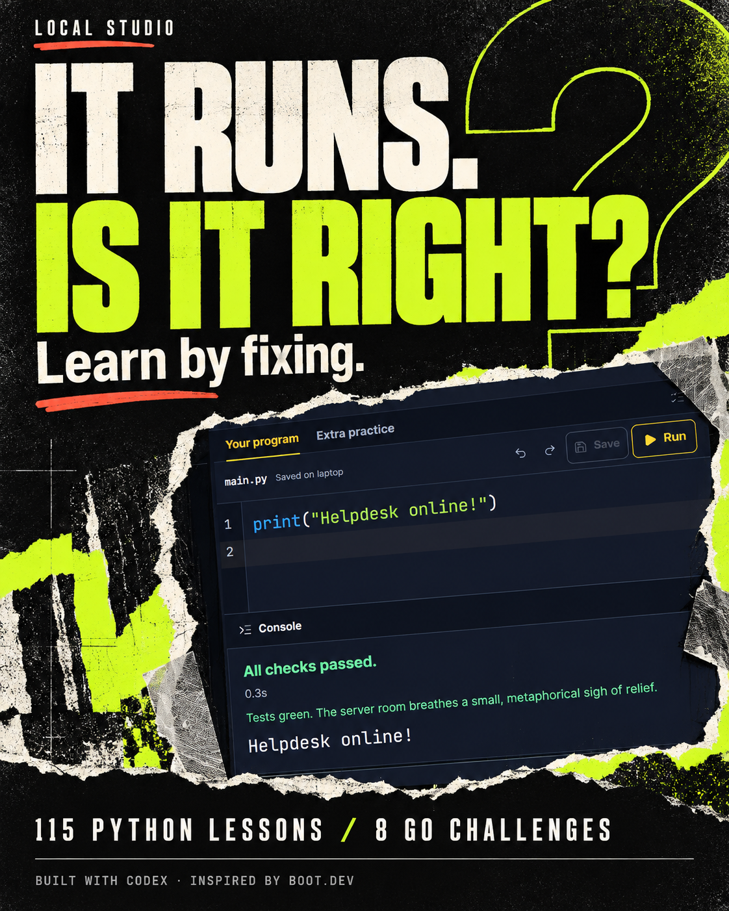

# Local Studio

A personal Python and Go learning workspace: read a lesson, edit real code, inspect its output and submit against executable checks.



[Watch the 18-second workflow](https://github.com/QasimAliSidhu/local-studio/raw/refs/heads/main/docs/social/demo.mp4) · [Enterprise roadmap](ENTERPRISE_ROADMAP.md) · [Source credits](CREDITS.md)

## What is available

- 115 Python lessons across 21 chapters, plus 8 Go challenges.
- Lesson text, a CodeMirror editor, a console and optional lesson-aware tutoring.
- Real Python/Go execution. Run experiments without recording completion; Submit runs the checks and saves passing completion.
- Fresh authored starters, optional reference solutions and separate scratchpad practice.
- Local saves, notes and progress, with a layout that adapts to phone-sized screens.

The first 17 Python missions are plain scripts. Custom function definitions follow the opening lessons on complete programs, values and variables.

## Run locally

Install Python 3.11 or newer. Install Go if you want to run the Go challenges; `go` must be available on your PATH. The web server uses Python's standard library, and built browser assets are included.

```sh
git clone https://github.com/QasimAliSidhu/local-studio.git
cd local-studio
python ui_server.py --open
```

Open http://127.0.0.1:8765 if the browser does not open automatically. An alternative port is supported with `--port 8766`.

The optional tutor uses your own local Codex CLI installation and sign-in. Core lessons, editing and execution do not need a tutor connection. No provider account, credentials or shared AI service is included.

This release is a local, single-user learning application. Its runner executes code on the host; it is not a sandbox for untrusted learners. Use it with your own trusted code. A shared enterprise deployment requires the isolation, identity and operational work in the roadmap.

## Development

UI source lives in `ui-src`; compiled, locally bundled assets live in `ui`. Node.js is only needed to rebuild the frontend:

```sh
cd ui-src
npm ci
npm run build
```

From the repository root, validate the Python curriculum and references:

```sh
python tools/build_python_course.py --check-only
python tools/verify_release.py
```

`verify_release.py` checks all 123 reference solutions when Go is installed, in a temporary learner workspace. It also checks the first lesson's wrong-output and passing-output flow. Neither command requires an AI request. The curriculum builder without `--check-only` installs generated course updates; read its source before using it on a workspace with learner changes.

Learner progress, notebooks, tutor conversations, machine-specific hosting, downloaded toolchains and browser profiles are excluded from this source release. Start with a new local learner workspace. See `.gitignore` before committing your own changes.

## Inspiration and credits

Built by Qasim Ali with Codex. Boot.dev and Lane Wagner inspired the hands-on learning approach. This independent project has its own lesson prose and exercises. [CREDITS.md](CREDITS.md) links the actual libraries, font projects and bundled upstream license notices.

The enterprise roadmap describes proposed capabilities. Organization workspaces, enterprise SSO and isolated shared runners are not shipped features of this release.
